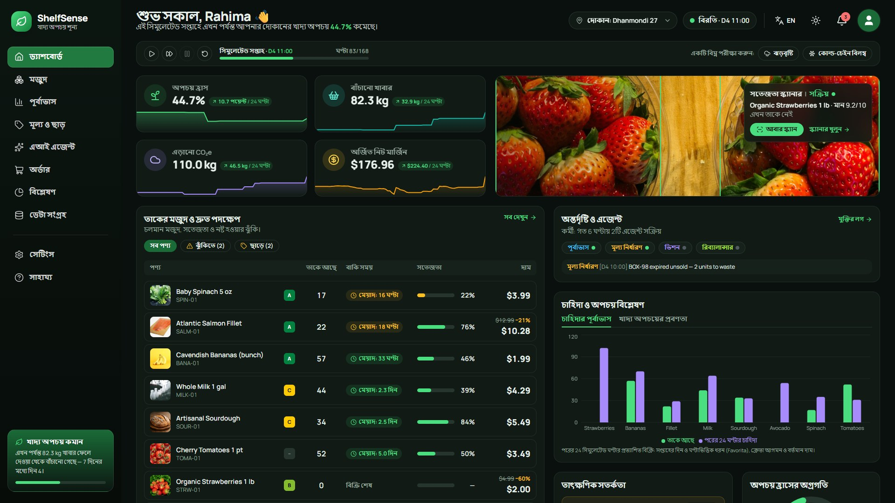
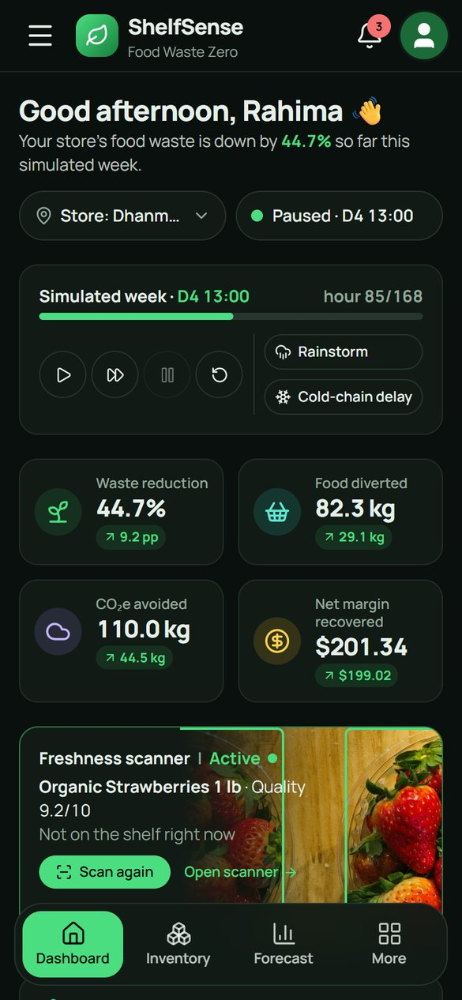

# ShelfSense

**AI shelf intelligence that cuts perishable food waste in grocery stores.**
Built for the FoodSphere AI domain (food-waste reduction in retail).

[](.github/workflows/ci.yml)

**Live demo:** https://shelfsense-tau.vercel.app — no sign-up needed, choose *Continue as guest*.
(The API runs on a free tier; the first load can take up to a minute while the server wakes.)


## The problem

Grocery stores price and reorder fresh food by the date printed on the label. But a bruised punnet
of strawberries spoils long before its date, a rainy day empties the shop, and a flat "50% off on
the last day" comes too late. The result is food in the bin and margin lost.

## What ShelfSense does

ShelfSense watches what is actually happening on the shelf and acts on it every hour:

- **Sees spoilage early.** A vision agent grades shelf photos (bruising, mould, ripening) and
  shortens the remaining shelf life of the damaged batch.
- **Forecasts demand.** Weather, weekday pattern, foot traffic and current price feed an hourly
  forecast for every product.
- **Prices dynamically.** Electronic shelf labels mark items down just enough to sell them before
  they spoil, with a price floor, and every price comes with its formula.
- **Orders smarter.** Purchase orders are throttled when shelves are already full or the weather
  turns.
- **Rescues the rest.** Short-dated leftovers become discounted *Flash Surplus Mystery Boxes*
  (keeping ethylene producers away from sensitive produce).

To prove it, ShelfSense runs a **twin-store simulation**: two stores serve the *same shoppers*
through the *same weather* for a 7-day, 168-hour week. One runs on printed dates, the other on
ShelfSense, and the dashboard shows the difference live.

| | Store A — baseline | Store B — ShelfSense |
|---|---|---|
| Ordering | Fixed order-up-to level | Weather- and weekday-adjusted forecast, throttled orders |
| Shelf life | Printed date | Effective-age model; camera scans recalibrate damaged batches |
| Pricing | 50% off on the last printed day | Elasticity-based markdown sized to the sales gap, with a price floor |
| Leftovers | Binned | Flash Surplus Mystery Boxes, ethylene-aware |

## Results

| Run | Waste reduction | Food diverted | CO₂e avoided | Margin recovered |
|---|---|---|---|---|
| Demo script (seed 42: rainstorm, cold-chain delay, damaged-strawberry scan) | **50.0%** | 106.6 kg | 150.7 kg | $769.71 |
| Benchmark (seeds 1–20, no events) | **57.8% ± 8.5** | | | |

The target was ≥ 30%. Parameters are never tuned per seed. Read *Limitations* before quoting
these numbers.

## Features

**Command-center dashboard**
- The **shelf inventory** is the main panel: every product with its photo, units on shelf, expiry
  countdown, freshness bar, Nutri-Score and live price, with *All / At risk / Discounted* filters.
  Click a product to open its step-by-step price formula.
- KPI cards (waste reduction, food diverted, CO₂e avoided, margin recovered) with 24-hour change
  and sparklines.
- **Freshness scanner**: scan the shelf and watch detections appear on the photo.
- **Shelf health** donut (fresh / ageing / at risk units), **real-time alerts**, agent activity,
  a demand-vs-stock chart and food-waste trend, and a waste-reduction gauge against the 30% target.
- A week player with play, fast-forward and restart, plus disruption buttons (*Rainstorm*,
  *Cold-chain delay*) to test how the system reacts.
- Switch every shelf view between your store and its **baseline twin** with one click.

**Pages**
- **Inventory**: every product, with filters and *Export CSV*.
- **Forecast**: expected sales for the next 24 hours per product.
- **Pricing & Discounts**: shelf-label prices and the markdown formula behind each one.
- **AI Agents**: the five agents, the shelf scanner (preset frames or your own photo) and the
  reasoning log, where every line can be explained in plain words.
- **Orders**: today's purchase orders vs the baseline's fixed reorder.
- **Analytics**: the full twin-store comparison, with *Export CSV*.
- **Data Ingestion**: every data source and its offline fallback.
- **Settings** and **Help**.

**AI you can check**
- Five agents (vision, knowledge/RAG, demand, pricing, procurement) share one message bus, and
  each logs *why* it acted, with numbers.
- **The language model never sets a price, shelf life or order.** Those are plain arithmetic from
  [`docs/SIMULATION_ENGINE.md`](docs/SIMULATION_ENGINE.md). The model only reads photos and
  writes explanations.
- **Explain in plain words**: answers are grounded in the log line's numbers, knowledge-graph
  facts and cited sources. An answer that contains a number not found in them is rejected and
  template text is shown instead.
- Retrieval: contextual chunks, BM25 or Gemini embeddings, plus a small knowledge graph for
  ethylene clashes (graph RAG).
- Assumed values (such as price elasticities) are labelled as assumptions in the formula
  inspector.

**Built for real use**
- Accounts with email confirmation (6-digit code), or continue as a guest. Each account keeps its
  own store and its simulated week between visits.
- **English and Bengali (বাংলা)** interface, light and dark themes (follows the OS until you pick
  one).
- Phone layout with a hamburger menu, bottom tabs and collapsible dashboard sections.
- **Runs fully offline**: no API keys, no internet. Every external call has a fallback (weather →
  recorded snapshot, Gemini vision → cached results, embeddings → BM25).

<details><summary>The same dashboard in Bengali</summary>



</details>

<details><summary>Demo week in motion (GIF)</summary>


</details>

Sign in, create an account, or continue as a guest:

 

On a phone:

 

## How it works

- `backend/app/sim/` — a pure, deterministic engine with no I/O: the same seed and events always
  give identical output. The maths is specified in
  [`docs/SIMULATION_ENGINE.md`](docs/SIMULATION_ENGINE.md).
- Agents are thin wrappers around the engine that log their reasoning; an orchestrator runs them
  each simulated hour.
- FastAPI streams one tick per simulated hour over `/ws/sim`; React + Zustand render the UI.
- Stack: Python 3.12, FastAPI, NumPy · React 18, TypeScript, Vite, Tailwind, Recharts · Google
  Gemini (optional) or a local model via Ollama / llama.cpp. Free tiers only.

Full design: [`docs/ARCHITECTURE.md`](docs/ARCHITECTURE.md) (with a decisions log). AI details:
[`docs/AI_PIPELINE.md`](docs/AI_PIPELINE.md). Prompts: [`docs/PROMPT_LIBRARY.md`](docs/PROMPT_LIBRARY.md).

## Run it locally

Needs Python 3.12 with [uv](https://docs.astral.sh/uv/) and Node 20+. No API keys required.

```bash
# backend  (http://localhost:8000)
cd backend
uv sync
uv run uvicorn app.main:app --reload --port 8000

# frontend (http://localhost:5173, proxies /api and /ws to :8000)
cd frontend
npm install
npm run dev
```

Weather: `WEATHER_PROVIDER=open_meteo` shows Dhaka weather (no key); `uv run python -m scripts.snapshot_open_meteo`
rebuilds the simulation's weather snapshot for that location. Product photos are Unsplash
(credits in `frontend/public/products/CREDITS.md`).

Headless run: `cd backend && uv run python -m app.sim.cli --hours 168 --seed 42 --scenario demo`
(`--seeds 1-20` for the benchmark, `--seeds 1-20 --calibrate` for Store A vs FAO waste rates).

Tests and checks: `uv run pytest -q` (92 tests) · `npm run typecheck && npm run lint && npm run build`.

### Optional: live AI

Copy `.env.example` to `.env`. With `VISION_MODE=live`, `GEMINI_API_KEY` and `GEMINI_VISION_MODEL`
set, camera scans and uploads go to Gemini; with `GEMINI_EMBED_MODEL` set and
`uv run python -m scripts.build_rag_index --vector`, retrieval uses embeddings. Without them the
app uses cached scan results and BM25 keyword search, and says so in the UI.

### Optional: plain-language explanations (Gemini or a local model)

Expand any agent log line and press **Explain in plain words**. `LLM_PROVIDER=gemini` uses your
Gemini key; for a fully local model install [Ollama](https://ollama.com), `ollama pull qwen2.5:3b`,
then set `LLM_PROVIDER=ollama` and `OLLAMA_MODEL=qwen2.5:3b`. Any OpenAI-compatible local server
works too (llama.cpp's `llama-server`, LM Studio): `LLM_PROVIDER=openai_compat`,
`OPENAI_COMPAT_URL`, `OPENAI_COMPAT_MODEL`. Without any of these it shows template text.

### MCP servers, automation, analytics

- **MCP:** five read-only servers, all reusing the app's own modules —
  `shelfsense-sim` (run a week, benchmark seeds, price formula, list products),
  `shelfsense-knowledge` (cited search, product graph, explain a decision; resources for the
  credits and the graph), `shelfsense-vision` (grade a preset frame or a local photo → α),
  `shelfsense-demand` (live weather with snapshot fallback, hourly demand forecast per SKU) and
  `shelfsense-warehouse` (read-only SQL over the DuckDB warehouse; build it first with
  `scripts.export_warehouse`). Claude Code picks them up from [`.mcp.json`](.mcp.json); elsewhere
  run `uv run python -m app.mcp.sim_server` (stdio) or add `--http` for streamable HTTP on
  `http://127.0.0.1:8765/mcp` (knowledge 8766, vision 8767, warehouse 8768, demand 8769).
- **Report API:** `GET /api/report?seed=42&scenario=demo` returns a whole simulated week as JSON
  (deterministic, cached).
- **n8n:** import [`automation/n8n/shelfsense_daily_report.json`](automation/n8n/shelfsense_daily_report.json):
  every morning (or via its webhook) it runs the week, summarises it and posts to a Slack/Discord
  webhook if you set one.
- **CI:** GitHub Actions runs tests, lint, the retrieval eval and the frontend build on every push,
  and weekly records the 20-seed benchmark and the warehouse export as an artifact.
- **Warehouse:** `uv run --group seed python -m scripts.export_warehouse` writes Parquet tables
  and a DuckDB file of 21 simulated weeks to `backend/data/warehouse/`.
- **RAG eval:** `uv run python -m scripts.eval_rag` (hit@3 and MRR on 30 labelled queries).
- **Optional database mirrors:** `scripts.sync_pgvector` (chunks + embeddings into pgvector on the
  same Postgres as `DATABASE_URL`) and `scripts.sync_neo4j` (the knowledge graph into Neo4j AuraDB
  Free or a local Neo4j). The app itself reads the committed files, so neither is required.

### Share your local copy

Run backend and frontend as above, then expose the Vite port with a free tunnel:
`cloudflared tunnel --url http://localhost:5173` (or `ngrok http 5173`). The Vite proxy forwards
`/api` and `/ws`, so one tunnel serves the whole app; Vite already allows `*.trycloudflare.com`
and `*.ngrok-free.app` hosts.

## Data and credits

| Source | Used for |
|---|---|
| USDA FSIS FoodKeeper (CC0) | Shelf lives (lower bound of storage range), citations |
| Open Food Facts (ODbL) | Nutri-Score, packaging for 6 reference products |
| Kaggle — Corporación Favorita | Weekday demand patterns (aggregates only, never raw rows) |
| NOAA api.weather.gov | Weather snapshot (NYC) and the live header widget |
| FAO (2011) Annex 4 | Retail waste rates, the calibration target for Store A |
| Poore & Nemecek (2018) via Our World in Data | CO₂e per kg |
| USDA AMS, UC Davis Postharvest Center | Ethylene producer / sensitive classes |
| Unsplash (Zoshua Colah, Matt L, Radek Sochocki) | Camera frames |

Details, licences and dates: [`backend/data/seed/CREDITS.md`](backend/data/seed/CREDITS.md) and
[`frontend/public/frames/CREDITS.md`](frontend/public/frames/CREDITS.md).

## Limitations — read before quoting the numbers

- **It's a simulation.** Prices, costs, daily volumes and suppliers are illustrative.
- **Elasticities are assumed** (−1.4 to −2.2). Half of any markdown's extra sales is treated as
  borrowed from later hours (assumed share 0.5); real promotions in the Favorita data lift sales only
  1.02–1.36×. A constant-elasticity model is available (`--demand-model constant`) but swings
  widely between seeds and does much worse (4.0% ± 33.3 vs 57.8% ± 8.5, seeds 1–20).
- **Store A is calibrated, not observed.** Shopper behaviour (70% pick the freshest unit), delivery
  schedules and Store A's stock level (1.25 cycles) were set so its waste lands near FAO retail rates; cherry
  tomatoes (10-day FoodKeeper life) never expire in a 7-day run.
- **Day-level forecast error is assumed** (CV 0.3), and Store B is otherwise well informed.
- **Vision fixtures are hand-checked.** Cached scans are a reviewed extraction of three stock photos,
  not a trained, validated grader.
- **Sessions are in memory:** each browser tab gets its own simulation (up to 25 at once); a server restart
  or sleep on the free tier starts everyone over.
