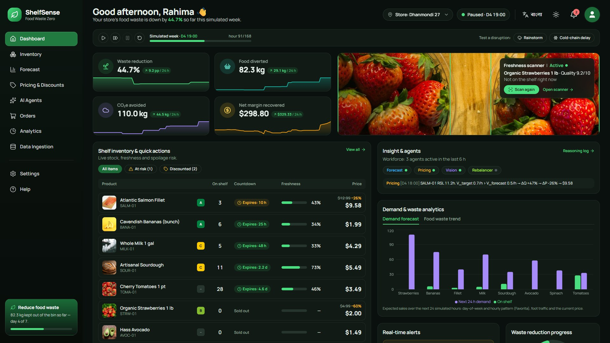
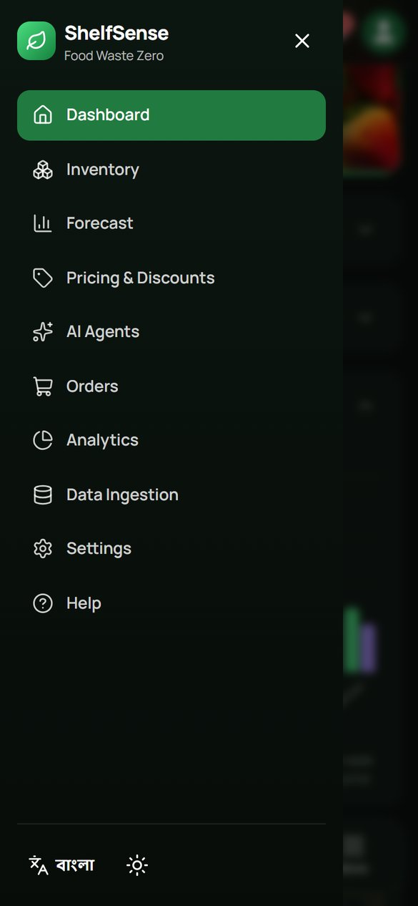

# ShelfSense

A twin-store grocery simulation that shows how much perishable food a store throws away when it
prices and orders by the printed date, and how much less it wastes when it prices and orders by
what is actually happening on the shelf. Built in the FoodSphere AI domain (food-waste reduction
in retail).

**Live demo:** https://shelfsense-tau.vercel.app (API: https://shelfsense-api-66nh.onrender.com — free tier, the first load may take up to a minute while the server wakes).



<details><summary>The same dashboard in Bengali</summary>


</details>

Sign in, create an account (confirmed with a 6-digit code by email), or continue as a guest; each account has its own store name and a simulated week that is saved between visits.

 

On a phone the sidebar becomes a hamburger menu and a bottom tab bar, and the dashboard's inventory, agent and analytics panels fold away.

 

The app is split into tabs: Dashboard, Inventory, Forecast, Pricing & Discounts, AI Agents, Orders,
Analytics, Data Ingestion, Settings (profile name and store, saved in the browser) and Help. A sun/moon button switches
between the light and dark themes (it follows the OS setting until you pick one). A language button switches the interface
between English and Bengali (বাংলা).

<details><summary>Demo week in motion (GIF, 1.2 MB)</summary>


</details>

Two stores serve the **same shoppers** (common random numbers) through the **same weather** for a
7-day, 168-hour week:

| | Store A — baseline | Store B — ShelfSense |
|---|---|---|
| Ordering | Fixed order-up-to level | Weather- and weekday-adjusted forecast, throttled POs |
| Shelf life | Printed date | Effective-age model; camera scans recalibrate damaged batches |
| Pricing | 50% off on the last printed day | Elasticity-based markdown sized to the velocity gap, with a price floor |
| Leftovers | Binned | Flash Surplus Mystery Boxes, ethylene-aware |

**Result (no events, seeds 1–20): 57.8% ± 8.5 less waste.** Demo script (seed 42, rain + cold-chain
delay + a damaged-strawberry scan): **50.0% less waste, 106.6 kg diverted, 150.7 kg CO₂e avoided,
$769.71 margin recovered.** See *Limitations* before quoting these.

## Run it locally

Needs Python 3.12 with [uv](https://docs.astral.sh/uv/) and Node 20+. No API keys required.

```bash
# backend  (http://localhost:8000)
cd backend
uv sync
uv run uvicorn app.main:app --reload --port 8000

# frontend (http://localhost:5173, proxies /api and /ws to :8000)
cd frontend
npm install
npm run dev
```

Weather: `WEATHER_PROVIDER=open_meteo` shows Dhaka weather (no key); `uv run python -m scripts.snapshot_open_meteo`
rebuilds the simulation's weather snapshot for that location. The store picker in the header switches
the shelf views between ShelfSense and its baseline twin, and *Export CSV* (Inventory, Analytics)
downloads the current run. Product photos are Unsplash (credits in `frontend/public/products/CREDITS.md`).

Headless run: `cd backend && uv run python -m app.sim.cli --hours 168 --seed 42 --scenario demo`
(`--seeds 1-20` for the benchmark, `--seeds 1-20 --calibrate` for Store A vs FAO waste rates).

Tests and checks: `uv run pytest -q` (90 tests) · `npm run typecheck && npm run lint && npm run build`.

### Optional: live AI

Copy `.env.example` to `.env`. With `VISION_MODE=live`, `GEMINI_API_KEY` and `GEMINI_VISION_MODEL`
set, camera scans and uploads go to Gemini; with `GEMINI_EMBED_MODEL` set and
`uv run python -m scripts.build_rag_index --vector`, retrieval uses embeddings. Without them the
app uses cached scan results and BM25 keyword search, and says so in the UI.

### Optional: plain-language explanations (Gemini or a local model)

Expand any agent log line and press **Explain in plain words**. The answer is grounded on the
line's numbers, knowledge-graph facts and cited sources, and is rejected (template text shown
instead) if it contains a number that isn't in them. `LLM_PROVIDER=gemini` uses your Gemini key;
for a fully local model install [Ollama](https://ollama.com), `ollama pull qwen2.5:3b`, then set
`LLM_PROVIDER=ollama` and `OLLAMA_MODEL=qwen2.5:3b`. Any OpenAI-compatible local server works too
(llama.cpp's `llama-server`, LM Studio): `LLM_PROVIDER=openai_compat`, `OPENAI_COMPAT_URL`,
`OPENAI_COMPAT_MODEL`. Without any of these it shows template text.

### MCP servers, automation, analytics

- **MCP:** five read-only servers, all reusing the app's own modules —
  `shelfsense-sim` (run a week, benchmark seeds, price formula, list products),
  `shelfsense-knowledge` (cited search, product graph, explain a decision; resources for the
  credits and the graph), `shelfsense-vision` (grade a preset frame or a local photo → α),
  `shelfsense-demand` (live weather with snapshot fallback, hourly demand forecast per SKU) and
  `shelfsense-warehouse` (read-only SQL over the DuckDB warehouse; build it first with
  `scripts.export_warehouse`). Claude Code picks them up from [`.mcp.json`](.mcp.json); elsewhere
  run `uv run python -m app.mcp.sim_server` (stdio) or add `--http` for streamable HTTP on
  `http://127.0.0.1:8765/mcp` (knowledge 8766, vision 8767, warehouse 8768, demand 8769).
- **Report API:** `GET /api/report?seed=42&scenario=demo` returns a whole simulated week as JSON
  (deterministic, cached).
- **n8n:** import [`automation/n8n/shelfsense_daily_report.json`](automation/n8n/shelfsense_daily_report.json):
  every morning (or via its webhook) it runs the week, summarises it and posts to a Slack/Discord
  webhook if you set one.
- **CI:** GitHub Actions runs tests, lint, the retrieval eval and the frontend build on every push,
  and weekly records the 20-seed benchmark and the warehouse export as an artifact.
- **Warehouse:** `uv run --group seed python -m scripts.export_warehouse` writes Parquet tables
  and a DuckDB file of 21 simulated weeks to `backend/data/warehouse/`.
- **RAG eval:** `uv run python -m scripts.eval_rag` (hit@3 and MRR on 30 labelled queries).
- **Optional database mirrors:** `scripts.sync_pgvector` (chunks + embeddings into pgvector on the
  same Postgres as `DATABASE_URL`) and `scripts.sync_neo4j` (the knowledge graph into Neo4j AuraDB
  Free or a local Neo4j). The app itself reads the committed files, so neither is required.

### Share your local copy

Run backend and frontend as above, then expose the Vite port with a free tunnel:
`cloudflared tunnel --url http://localhost:5173` (or `ngrok http 5173`). The Vite proxy forwards
`/api` and `/ws`, so one tunnel serves the whole app; Vite already allows `*.trycloudflare.com`
and `*.ngrok-free.app` hosts.

## How to demo it (about 3 minutes)

0. **Sign in, create an account, or continue as a guest.** Each account gets its own store name and
   its own simulated week, saved to the database (pick it up in another tab, device or after a
   redeploy); guests get a fresh week per tab. New accounts confirm their email with a 6-digit code.
1. **Reset → Demo script.** Two identical stores, same shoppers, same weather.
2. **Play.** Store B's shelf labels mark down short-life items; the log explains each price with numbers.
3. The script adds a **rainstorm** (Day 2 10:00): demand, pricing and purchase-order lines appear; open *Purchase orders*.
4. Day 4 14:00: a **Frame 3 scan** of damaged strawberries; shelf life drops and the label reprices next hour. Click a label for the step-by-step formula.
5. **Fast-forward.** Surplus boxes appear in *Flash surplus boxes*.
6. Day 7 23:00: final KPIs. Open **System architecture** for the live status of every part.

## How it works

- `backend/app/sim/` — a pure, deterministic engine (no I/O): same seed + same events ⇒ identical
  output. The maths is specified in [`docs/SIMULATION_ENGINE.md`](docs/SIMULATION_ENGINE.md).
- Agents (demand, pricing, procurement, vision, RAG) are thin wrappers that log *why*. The vision
  model only extracts what it sees and retrieved text only explains decisions; no LLM ever sets a
  price, shelf life or order.
- FastAPI streams a tick per simulated hour over `/ws/sim`; React + Zustand render five zones.
- Every external dependency has an offline fallback (NOAA → snapshot, Gemini → cached fixtures,
  embeddings → BM25).

- Retrieval: semantic chunks with LLM-written context sentences (contextual retrieval), BM25 or
  Gemini embeddings, plus a small knowledge graph for ethylene clashes (graph RAG).

Full design: [`docs/ARCHITECTURE.md`](docs/ARCHITECTURE.md) (with a decisions log). AI details:
[`docs/AI_PIPELINE.md`](docs/AI_PIPELINE.md). Prompts: [`docs/PROMPT_LIBRARY.md`](docs/PROMPT_LIBRARY.md).

## Data and credits

| Source | Used for |
|---|---|
| USDA FSIS FoodKeeper (CC0) | Shelf lives (lower bound of storage range), citations |
| Open Food Facts (ODbL) | Nutri-Score, packaging for 6 reference products |
| Kaggle — Corporación Favorita | Weekday demand patterns (aggregates only, never raw rows) |
| NOAA api.weather.gov | Weather snapshot (NYC) and the live header widget |
| FAO (2011) Annex 4 | Retail waste rates, the calibration target for Store A |
| Poore & Nemecek (2018) via Our World in Data | CO₂e per kg |
| USDA AMS, UC Davis Postharvest Center | Ethylene producer / sensitive classes |
| Unsplash (Zoshua Colah, Matt L, Radek Sochocki) | Camera frames |

Details, licences and dates: [`backend/data/seed/CREDITS.md`](backend/data/seed/CREDITS.md) and
[`frontend/public/frames/CREDITS.md`](frontend/public/frames/CREDITS.md).

## Limitations — read before quoting the numbers

- **It's a simulation.** Prices, costs, daily volumes and suppliers are illustrative.
- **Elasticities are assumed** (−1.4 to −2.2). Half of any markdown's extra sales is treated as
  borrowed from later hours (assumed share 0.5); real promotions in the Favorita data lift sales only
  1.02–1.36×. A constant-elasticity model is available (`--demand-model constant`) but swings
  widely between seeds and does much worse (4.0% ± 33.3 vs 57.8% ± 8.5, seeds 1–20).
- **Store A is calibrated, not observed.** Shopper behaviour (70% pick the freshest unit), delivery
  schedules and Store A's stock level (1.25 cycles) were set so its waste lands near FAO retail rates; cherry
  tomatoes (10-day FoodKeeper life) never expire in a 7-day run.
- **Day-level forecast error is assumed** (CV 0.3), and Store B is otherwise well informed.
- **Vision fixtures are hand-checked.** Cached scans are a reviewed extraction of three stock photos,
  not a trained, validated grader.
- **Sessions are in memory:** each browser tab gets its own simulation (up to 25 at once); a server restart
  or sleep on the free tier starts everyone over.

## Deploying (free tiers)

- **Backend → Render:** New → Blueprint → this repo (uses [`render.yaml`](render.yaml)). Set
  `CORS_ORIGINS` to the Vercel URL, `NOAA_USER_AGENT` to an app name + contact, and optionally the
  Gemini variables. For accounts set `DATABASE_URL` to a Postgres URL (Neon free tier);
  `AUTH_SECRET` is generated by the blueprint. For sign-up codes set `SMTP_USER` (a Gmail address)
  and `SMTP_PASSWORD` (a Google app password); without them new accounts are paused. Without `DATABASE_URL` accounts fall back to a
  SQLite file that Render's free disk wipes on every restart. Free instances sleep when idle; the UI shows "Waking the simulation server…"
  and reconnects by itself.
- **Frontend → Vercel:** import the repo with root directory `frontend` (Vite preset). Set
  `VITE_API_URL=https://<render-app>.onrender.com` and
  `VITE_WS_URL=wss://<render-app>.onrender.com/ws/sim`.
